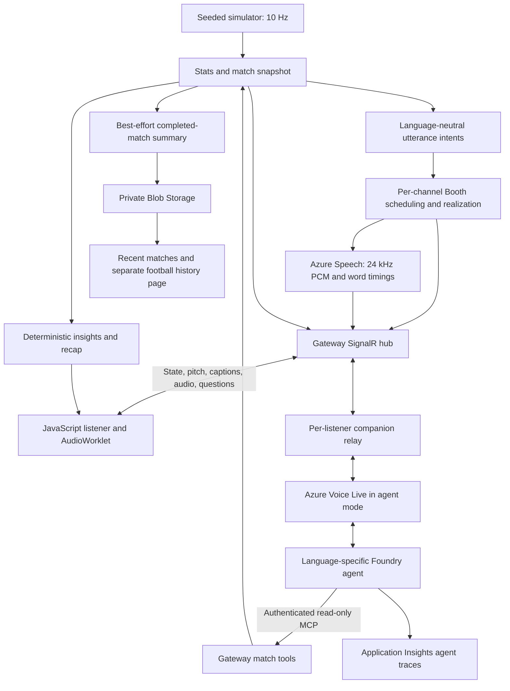

# Architecture

[Back to README](README.md)

Voice of the Game combines a deterministic synthetic football simulation with scheduled audio description and a grounded conversational companion. This document describes the implemented system, not a future platform or a deployment inventory.

## System Overview

The commentary path uses phrase banks and deterministic scheduling, not an LLM. The LLM is used for companion answers. Hosted Foundry workflows, Fabric, Azure SignalR and Blazor are not part of this implementation.

## Code Organization

| Location | Responsibility |
|---|---|
| [Vog.Contracts](src/Vog.Contracts) | Shared tracking, match/scene-event, pitch and utterance records |
| [Vog.Domain](src/Vog.Domain) | Pitch, clock, fictional leagues, seeded RNG and football models |
| [Vog.Simulator](src/Vog.Simulator) | Seeded match engine emitting tracking and events |
| [Vog.Stats](src/Vog.Stats) | Ball state, motion, enriched events and cumulative statistics |
| [Vog.Describe](src/Vog.Describe) | Utterance intents, phrase realization, reminders and braille briefs |
| [Vog.PhraseBanks](src/Vog.PhraseBanks) | YAML assets embedded by Vog.Describe; not a separate compiled project |
| [Vog.Booth](src/Vog.Booth) | Channel priorities, serial scheduling, staleness, interruptions and coverage |
| [Vog.Pipeline](src/Vog.Pipeline) | Offline and wall-clock composition, immutable match snapshots |
| [Vog.Voice](src/Vog.Voice) | Azure Speech, PCM/WAV output, word timing and captions |
| [Vog.Companion](src/Vog.Companion) | Snapshot query tools and Voice Live sessions |
| [Vog.Gateway](src/Vog.Gateway) | ASP.NET Core host, static listener, broadcast, SignalR, MCP and storage |
| [Vog.Replay](tools/Vog.Replay) | Offline inspection, speech rendering and gateway/companion smoke clients |
| [Vog.FoundrySetup](tools/Vog.FoundrySetup) | Registers language-specific prompt agents from the shared YAML definition |
| [Vog.DataPrep](tools/Vog.DataPrep) | Optional regeneration of historical aggregates from a stored results CSV |
| [infra](infra) | Bicep modules and Azure CLI provisioning/teardown |
| [scripts](scripts) | Quality evaluations, managed red-team scans and result collection |
| [tests](tests) | .NET, browser-module and mocked provisioning checks |

## Match And Commentary Lifecycle

[MatchPipeline](src/Vog.Pipeline/MatchPipeline.cs) runs the simulator at 100 ms intervals. Stats processing enriches each tick, publishes an immutable snapshot, and provides the facts used to create language-neutral utterance intents. Separate Booth schedulers realize and schedule those intents for each language/mode channel.

[LiveBroadcastService](src/Vog.Gateway/LiveBroadcastService.cs) starts the shared match on the first valid listener join, including a text-only join. Subsequent joins, channel changes and Stop/Start do not reset it. Once started, matches continue even when no listeners remain. The configured seed repeats after each between-match break. Restarting the gateway loses in-memory state and returns to first-listener kickoff. Independent gateways do not synchronize their matches.

Defaults are seed `20261026`, speed `1` and a `120`-second break. State updates run at 1 Hz and pitch updates at 5 Hz. The nine live channels are English, Spanish and Tamil, each with AudioDescription, Commentary and Calm. Casual/Analyst are insight presentation views, not extra live audio channels. Replay offers additional offline modes. Above 4x speed, spoken commentary is limited to goals and period changes.

The Booth schedules a serial narration channel using priority, preemption, staleness, ball-location obligations and dead-ball detail. The [coverage meter](src/Vog.Booth/CoverageMeter.cs) tracks location-mention gaps. Simulator realism and scheduling behavior are exercised by the simulator and golden-match tests; they are not proof of human accessibility outcomes.

## Speech And Browser Delivery

[SpeechWorker](src/Vog.Gateway/SpeechWorker.cs) synthesizes scheduled utterances for active audio channels, not separately for every listener. Its pending queue holds at most 64 utterances with priority-aware eviction. Stale work can be skipped; a failed synthesis gets one retry only if no audio has been emitted. Workers warm on joining, and queued/warm-up work can continue after listeners leave.

Azure Speech returns 24 kHz, 16-bit mono PCM and word timings. Self-hosted SignalR at `/hubs/commentary` transports JSON, including base64 audio. The browser converts audio for AudioWorklet playback and uses caption cues for word-timed text. Booth interruptions send a sample cutoff; live playback applies a fade at that limit. Offline word-boundary cutting is a separate capability. Per-utterance PCM buffering remains unbounded.

The [listener modules](src/Vog.Gateway/wwwroot/js) implement device-local preferences, captions, pitch rendering, sound controls and question handling. Chart.js and SignalR are served locally; no runtime CDN is needed for them. Browser audio timing measures utterance receipt to playback start, not total event-to-ear latency.

Backend text groups and braille-brief generation exist, but the listener does not expose a text-only/braille mode selector or live braille feed.

## Companion And Match Tools

Typed input or microphone audio reaches [CompanionRelay](src/Vog.Gateway/CompanionRelay.cs) through the SignalR hub. Each listener gets a lazily created Azure Voice Live agent-mode session. The browser stops recording; server turn detection is disabled. Answer text and audio return only to that listener.

The [agent definition](foundry/agents/vog-match-companion.agent.yaml) expands into `vog-match-companion-en-gb`, `vog-match-companion-es-es` and `vog-match-companion-ta-in`. Foundry calls stateless HTTP MCP at `/mcp/{lang}`, authenticated with `X-Api-Key`. The [MCP adapter](src/Vog.Gateway/MatchMcp.cs) exposes six read-only [match tools](src/Vog.Companion/MatchTools.cs):

| Tool | Grounding data |
|---|---|
| `get_score_and_time` | Score, clock and match phase |
| `get_ball_and_possession` | Ball location and possession |
| `get_recent_events` | Recent match events; default five, capped at ten |
| `get_match_stats` | Cumulative match statistics |
| `get_match_recap` | Scoped event counts, highlights and source evidence |
| `get_player` | Player lookup by name fragment or shirt number |

Score and ball shortcuts use deterministic text plus Speech; Who scored uses the agent. A locally running gateway does not automatically replace the MCP target registered in Foundry, so local and deployed match facts must not be assumed identical.

The question UI supports tap-to-ask, local silence detection, hold-to-ask, keyboard interaction and typed input. Commentary is muted during recording and ducked during answers. Current bounds include 20 seconds of input audio, 300 text characters, 50 questions per conversation and a 120-second browser watchdog. Reconnection resets the conversation limit; it is not a durable quota. After a sent question fails or times out, Stop/Start is required to isolate late answers because server responses lack per-question correlation. Companion command/event buffers remain unbounded.

Text catch-up selects up to six prioritized utterances received while asking/listening to an answer. It is not a full match replay and cannot recover commentary the browser never received. Spoken catch-up and hands-free echo cancellation are not implemented.

## Insights And Persistence

The public `/insights` endpoint reuses deterministic recap logic over one immutable snapshot. It returns raw counts, event IDs and factual highlights, not inferred tactics or model-generated probabilities. `recent` covers at most two match-clock minutes within the current half; `match` covers play so far; `halftime` remains first-half-only after availability; `fulltime` requires the final whistle. Casual selects highlights; Analyst adds a Chart.js count chart and exact values. Auto-refresh pauses in hidden tabs and while the panel has focus or evidence is open.

[MatchArchiveService](src/Vog.Gateway/MatchArchiveService.cs) attempts a fire-and-forget summary upload after each completed match to `vog-data/match-snapshots/<seed>/<timestamp>.json`. It does not persist full event streams, audio or recoverable live state. Upload failures are logged without retry. `/history` selects the newest stored summary per `(seed, homeName, awayName)` and returns at most ten fixtures. An empty result can mean no archives, disabled storage or a read failure.

The separate [Football history page](src/Vog.Gateway/wwwroot/football-history.html) reads only `goals-per-decade.json` and `home-advantage.json` through `/data/{file}`. Those aggregates originate from real CC0 international results and never feed the simulator or companion. Raw CSVs remain private. Successful aggregates are publicly cacheable for one hour; missing data returns 404 and storage failures return 503. Home-win percentages include neutral venues and are not a causal home-advantage measurement.

## Azure Resources And Configuration

[main.bicep](infra/main.bicep) provisions the user-assigned managed identity and roles, Key Vault, ACR, Container Apps environment/gateway, private Blob Storage, Log Analytics, Application Insights, Foundry account/project, model deployments, guardrail and project connections. The gateway uses one always-on replica because live state and listener sessions reside in memory.

| Setting | Purpose |
|---|---|
| `VOG_KEY_VAULT_URI` | Required gateway vault endpoint; supplies the MCP secret |
| `VOG_AI_ENDPOINT` | Required Azure AI endpoint |
| `VOG_AI_SERVICES_ENDPOINT` | Required AI services endpoint |
| `VOG_FOUNDRY_PROJECT_ENDPOINT` | Required project endpoint for agents |
| `Mcp:ApiKey` / `Mcp__ApiKey` | MCP credential, at least 32 characters; normally loaded from Key Vault secret `Mcp--ApiKey` |
| `VogStorage__BlobEndpoint` | Optional historical-data and match-archive storage endpoint |
| `Broadcast__Seed`, `Broadcast__Speed`, `Broadcast__BreakSeconds` | Explicit simulation overrides |

Provisioning writes nonsecret endpoints into ignored `.env.local`; the gateway searches ancestor folders for local settings and honors environment configuration. Local service authentication uses Azure CLI and hosted authentication uses managed identity. The gateway requires cloud configuration even if only the static listener is being tested. FoundrySetup also receives the model deployment, guardrail, MCP URL and connection prefix from provisioning.

The default agent deployment is `gpt-5.6-terra` version `2026-07-09` (GlobalStandard capacity 800); the independent judge is `gpt-4.1` version `2025-04-14` (capacity 30). Availability and quota are subscription/region-dependent. Provisioning parameters control model selection; code defaults are not evidence of a particular live deployment.

## Security And Observability

Foundry API access uses Entra authentication, not model keys. MCP uses a separate application secret stored in Key Vault and language-specific Foundry connections. Provisioning reuses an existing key and stops if that key cannot be read; it does not silently rotate it. Secret deployment parameters are temporary and removed in `finally`. Do not commit dotenv files, credentials, generated audio or unreviewed transcripts.

Blob anonymous access and shared-key authentication are disabled; application/developer permissions are container-scoped. Public listener, stats, insight and history routes are not protected by durable user authentication or quotas. Read-only MCP tools and prompt restrictions reduce available actions but do not guarantee safe answers.

[foundry-tracing.bicep](infra/modules/foundry-tracing.bicep) creates the project-wide default Application Insights connection. Gateway telemetry configuration alone does not enable agent traces. The connection uses connection-string ingestion resolved during deployment, not managed-identity ingestion. The provisioning user receives Monitoring Reader and Log Analytics Reader. Retention is 30 days; trace data may contain inputs, outputs and tool results. New calls generate traces after ingestion delay; older calls are not backfilled.

`/healthz` is a process probe, not a dependency check. `/stats` exposes accumulated runtime metrics, not a controlled benchmark. Managed quality/red-team evaluations are separate from offline regression tests. Their runners discover and pin current agent versions, authenticate through Azure CLI, submit asynchronously and collect paginated evidence. Details and commands are in the [README](README.md#evaluations-and-tracing).

## Recreation And Failure Boundaries

[provision.ps1](infra/provision.ps1) converges infrastructure, recovers matching soft-deleted resources, builds the current worktree in ACR, seeds the two historical aggregates, registers all three agents, then submits quality and red-team evaluations. It never deletes the group or purges retained resources. Registration/evaluation versions are intentionally new each run.

Recreation restores configuration and seed aggregates, not old archives, evaluation results, traces, images or secret values. Preserve needed records separately before deletion. [teardown.ps1](infra/teardown.ps1) deletes the entire selected group and attempts to purge its AI accounts and vaults; its final message does not independently verify purge success. Provisioning tests simulate fresh, recovered and existing environments, but a full destructive live rebuild is not verified.

The system remains single-instance, has best-effort archives, and has incomplete bounds on some audio/companion buffers. Spanish/Tamil phrase banks retain draft metadata. Native-language, assistive-technology, microphone and subjective audio validation are distinct from automated tests. See [limitations](README.md#scope-and-limitations) before treating implementation completion as operational or accessibility certification.